# Manual de usuario: KollectA

KollectA es una red social para fans del K-pop. Sirve para publicar, chatear, armar tu colección de merch y comprar, vender o intercambiar piezas con otras personas.

- **Dirección:** https://kollecta.onrender.com
- **Navegadores:** Chrome, Edge o Firefox actualizados. Funciona también en el celular.
- **Capturas:** se tomaron con datos de demostración. Los números amarillos de cada imagen corresponden a la lista que va debajo.

> En el plan gratuito de Render el servidor se duerme si nadie lo usa. La primera vez puede tardar unos 30 segundos en abrir.

## Contenido

1. [Cuentas y roles](#1-cuentas-y-roles)
2. [Iniciar sesión](#2-iniciar-sesión)
3. [Crear una cuenta](#3-crear-una-cuenta)
4. [Inicio (feed)](#4-inicio-feed)
5. [Detalle de una publicación](#5-detalle-de-una-publicación)
6. [Buscar](#6-buscar)
7. [Notificaciones](#7-notificaciones)
8. [Mensajes y chats grupales](#8-mensajes-y-chats-grupales)
9. [Grupos](#9-grupos)
10. [Detalle de un grupo](#10-detalle-de-un-grupo)
11. [Marketplace](#11-marketplace)
12. [Detalle de un producto](#12-detalle-de-un-producto)
13. [Vender o intercambiar](#13-vender-o-intercambiar)
14. [Mis órdenes](#14-mis-órdenes)
15. [Detalle de una orden y disputas](#15-detalle-de-una-orden-y-disputas)
16. [Mi colección](#16-mi-colección)
17. [Perfil y reseñas](#17-perfil-y-reseñas)
18. [Reportes](#18-reportes)
19. [Moderación (moderadores y administradores)](#19-moderación-moderadores-y-administradores)
20. [Denunciar contenido](#20-denunciar-contenido)
21. [Preguntas frecuentes](#21-preguntas-frecuentes)

---

## 1. Cuentas y roles

Para usar KollectA hay que iniciar sesión; lo único que se ve sin cuenta es el registro. Cada cuenta tiene un rol, y cada rol puede hacer todo lo del anterior:

| Rol | Qué puede hacer |
|---|---|
| **Usuario** | Publicar, comentar, chatear, armar su colección, comprar, vender, intercambiar, denunciar y ver sus propios reportes. |
| **Moderador** (insignia *Mod*) | Además: revisar denuncias y disputas, ocultar contenido, suspender cuentas de 1 a 30 días y ver los reportes de moderación. |
| **Administrador** (insignia *Admin*) | Además: banear o reactivar cuentas, cambiar roles y ver todos los reportes de la plataforma. |

Las opciones de **Gestión** del menú lateral (Reportes y Moderación) cambian según tu rol.

---

## 2. Iniciar sesión

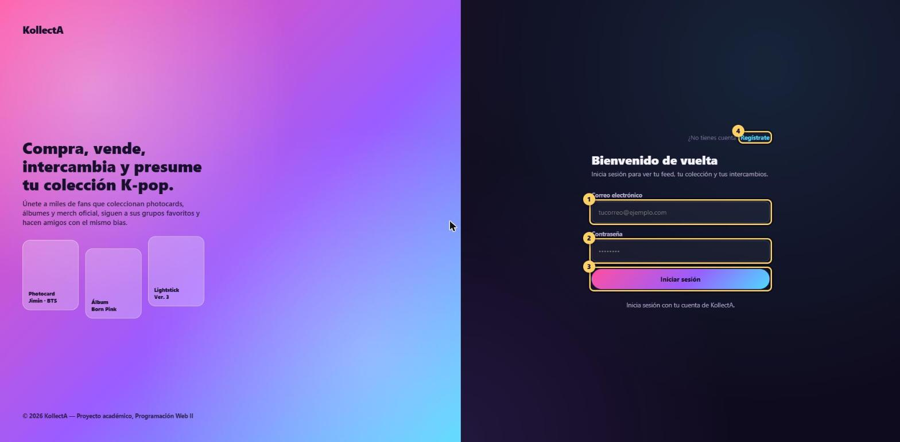

1. **Correo electrónico** con el que te registraste.
2. **Contraseña.**
3. **Iniciar sesión.** Si los datos son correctos entras al Inicio.
4. **Regístrate:** abre el formulario para crear una cuenta nueva.

Si tu cuenta está suspendida o baneada, aquí aparece el motivo y, si es una suspensión, la fecha en que termina.

---

## 3. Crear una cuenta

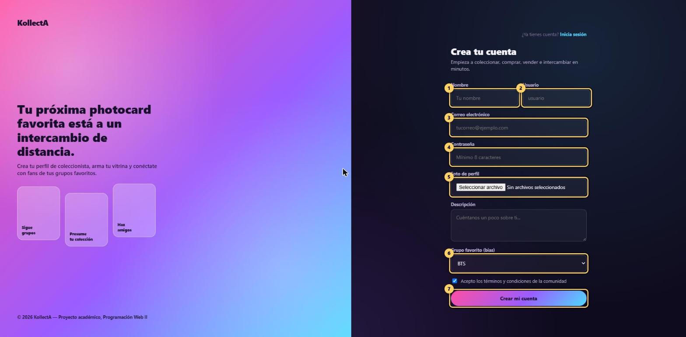

1. **Nombre** que verán los demás.
2. **Usuario:** tu @nombre único, sin espacios.
3. **Correo electrónico:** no puede estar registrado antes.
4. **Contraseña:** mínimo 8 caracteres.
5. **Foto de perfil** (opcional).
6. **Grupo favorito (bias):** aparece en tu perfil y personaliza tu feed.
7. **Crear mi cuenta.** Antes hay que aceptar los términos de la comunidad (la casilla de arriba). Al terminar entras directo a la app.

---

## 4. Inicio (feed)

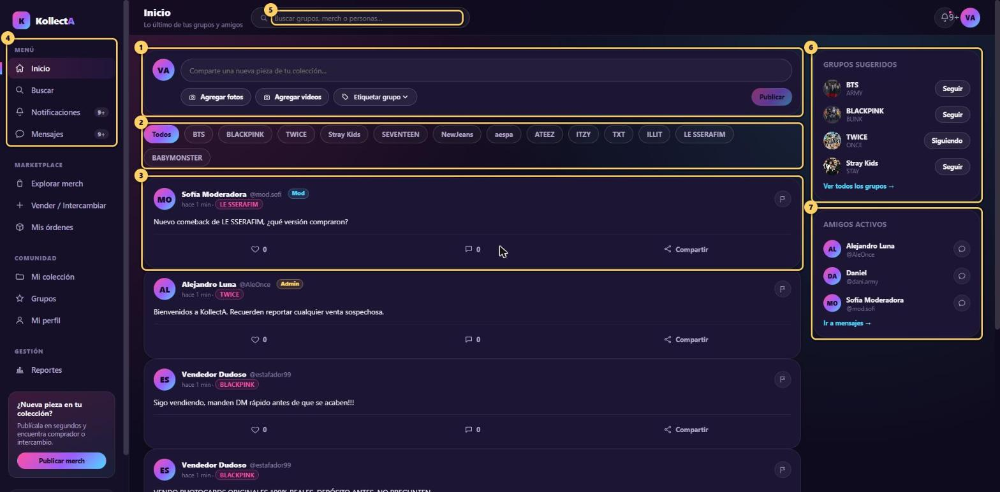

1. **Nueva publicación:** escribe un texto y, si quieres, agrega hasta 10 fotos y 5 videos. Con **Etiquetar grupo** eliges el grupo de la publicación. Al final pulsa **Publicar**.
2. **Filtro por grupo:** muestra solo las publicaciones de un grupo.
3. **Publicación:** dale ❤ para dar like, abre los comentarios con 💬 o compártela. La banderita de la derecha sirve para denunciarla ([§20](#20-denunciar-contenido)).
4. **Menú lateral:** lleva a todas las secciones. El número junto a Notificaciones y Mensajes indica cuántos tienes sin leer.
5. **Buscador:** encuentra grupos, merch o personas ([§6](#6-buscar)).
6. **Grupos sugeridos:** síguelos con un clic.
7. **Amigos activos:** abre un chat con un amigo.

> **Emojis y GIFs:** junto a los botones de fotos están **😊**, que abre los emojis por categoría, y **GIF**, que abre un buscador de GIFs animados. Puedes publicar solo un GIF, o un GIF con texto. Antes de publicar, la **✕** quita el GIF elegido.

---

## 5. Detalle de una publicación

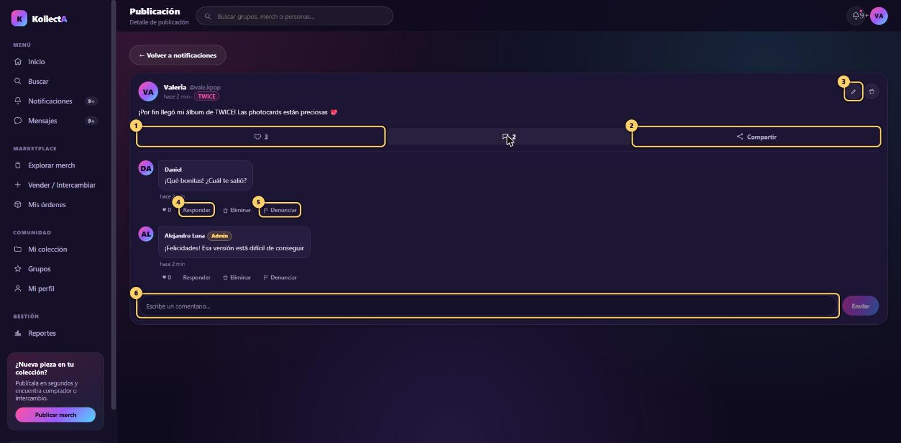

1. **Like:** muestra cuántos tiene.
2. **Compartir.**
3. **Editar** (lápiz) o **borrar** (bote). Solo aparecen en tus propias publicaciones.
4. **Responder** a un comentario.
5. **Denunciar** un comentario.
6. **Escribe un comentario** y pulsa **Enviar**. Si escribes @usuario, esa persona recibe una notificación de mención. Con **😊** y **GIF** agregas emojis o un GIF, también en las respuestas.

---

## 6. Buscar

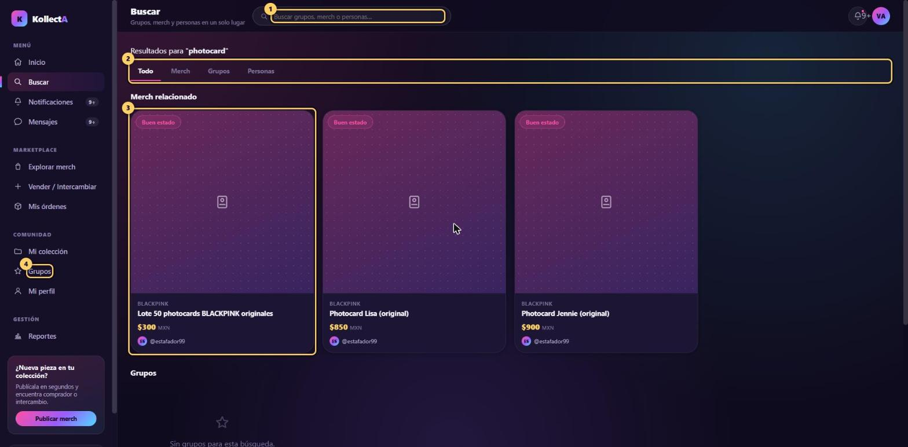

1. Escribe en el **buscador** de la barra superior y pulsa Enter.
2. **Pestañas:** muestran todo junto o solo **Merch**, **Grupos** o **Personas**.
3. **Resultado:** al hacer clic se abre el producto, grupo o perfil.
4. Para ver todos los grupos sin buscar, entra a **Grupos** en el menú.

---

## 7. Notificaciones

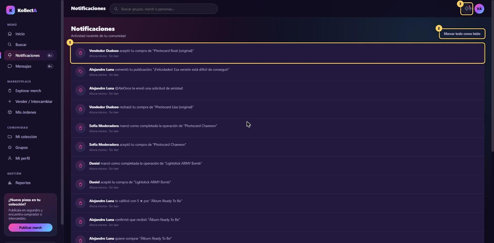

1. **Notificación:** al hacer clic te lleva a lo que pasó (la publicación, la orden, la solicitud de amistad…). Avisan de likes, comentarios, menciones, solicitudes de amistad, cambios en tus órdenes y decisiones de moderación.
2. **Marcar todo como leído.**
3. **Campana:** desde cualquier pantalla muestra cuántas notificaciones tienes sin leer.

---

## 8. Mensajes y chats grupales

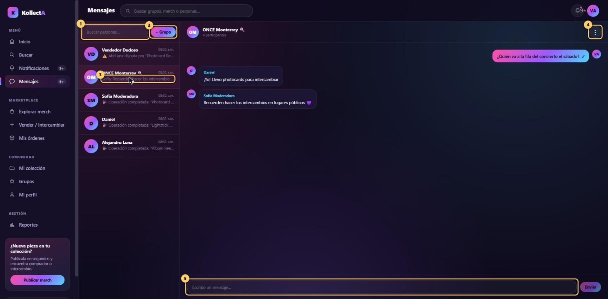

1. **Buscar personas:** escribe un nombre para empezar un chat nuevo.
2. **+ Grupo:** crea un chat grupal. Ponle nombre y elige a los participantes.
3. **Conversación:** muestra el último mensaje y la hora. Cuando haces una compra o un intercambio, el chat con la otra persona se abre solo.
4. **Opciones de la conversación:** ver participantes y, en un grupo, cambiar el nombre, agregar o quitar personas (si eres administrador del grupo) o **Salir del grupo**.
5. **Escribe un mensaje** y pulsa **Enviar**. La palomita ✓ indica que se entregó. Los mensajes llegan en tiempo real. A la izquierda del campo, **😊** agrega emojis y **GIF** manda un GIF animado.

---

## 9. Grupos

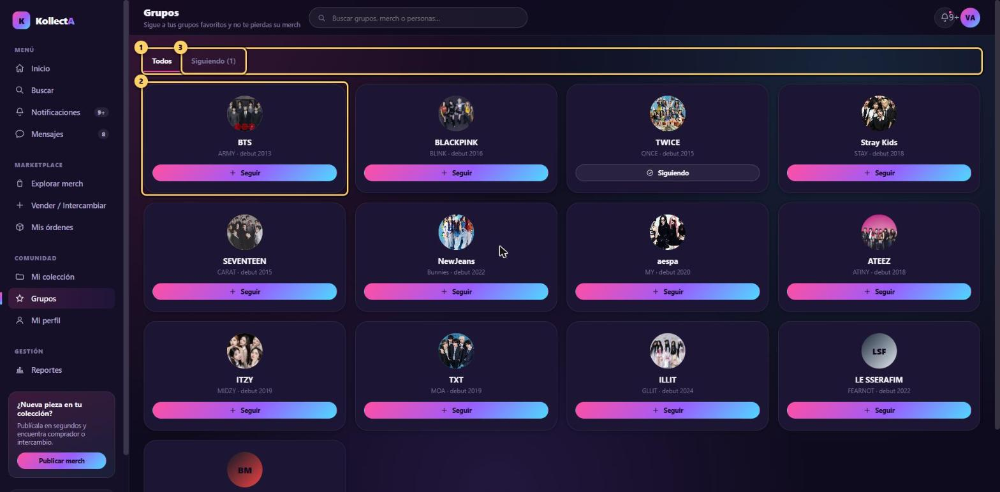

1. **Todos / Siguiendo:** cambia entre todos los grupos y los que sigues.
2. **Tarjeta del grupo:** clic para ver el detalle, o **Seguir** para agregarlo a tus grupos.
3. **Siguiendo (n):** cuántos grupos sigues.

---

## 10. Detalle de un grupo

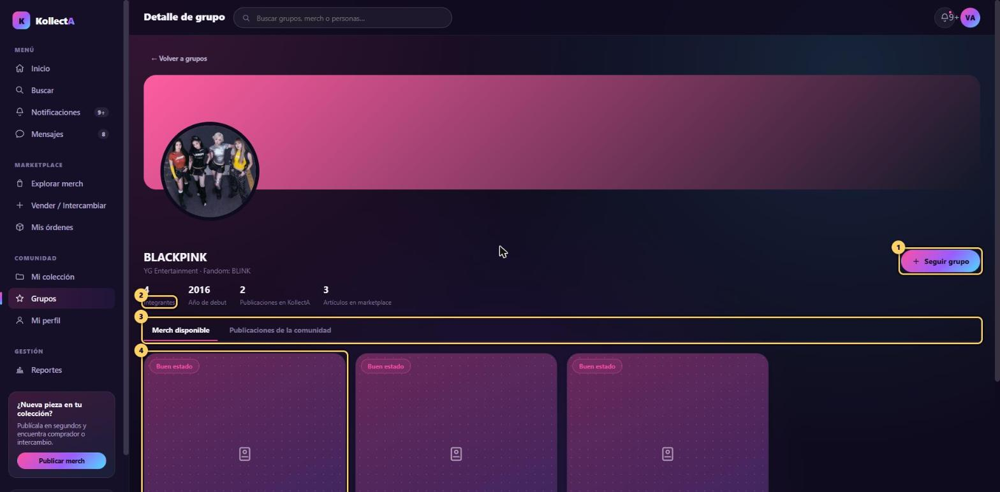

1. **Seguir grupo** o dejar de seguirlo.
2. **Datos del grupo:** integrantes, año de debut, publicaciones en KollectA y artículos en el marketplace.
3. **Pestañas:** el merch disponible del grupo o las publicaciones de la comunidad sobre él.
4. **Artículo en venta:** clic para ver el producto.

---

## 11. Marketplace

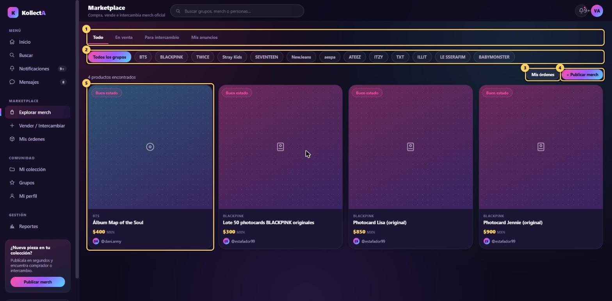

1. **Pestañas:** **Todo**, **En venta**, **Para intercambio** y **Mis anuncios** (tus productos publicados, donde puedes editarlos o retirarlos).
2. **Filtro por grupo.**
3. **Mis órdenes:** tus compras, ventas e intercambios ([§14](#14-mis-órdenes)).
4. **+ Publicar merch:** pone un artículo a la venta ([§13](#13-vender-o-intercambiar)).
5. **Producto:** muestra foto, grupo, título, precio y vendedor. Clic para ver el detalle.

> En esta etapa KollectA **no cobra dentro de la app**. Las personas acuerdan el pago (transferencia o efectivo) y la app registra y da seguimiento a la operación.

---

## 12. Detalle de un producto

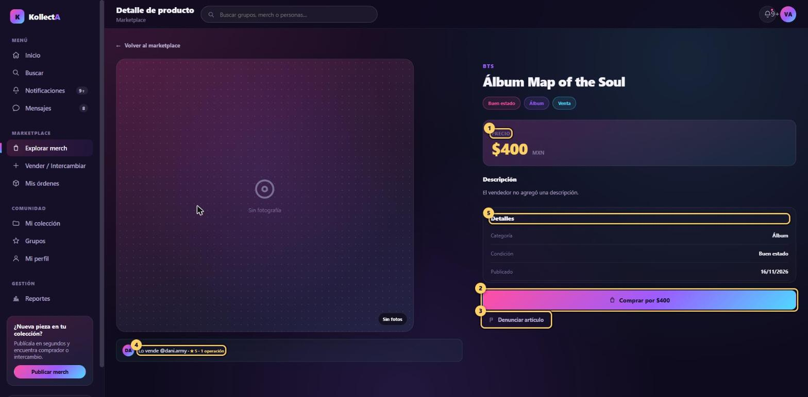

1. **Precio** en pesos mexicanos.
2. **Comprar:** envía la solicitud al vendedor y abre el chat con él. Si el producto acepta intercambio, aparece **Proponer intercambio**: ahí eliges hasta 5 piezas de tu colección para ofrecer a cambio.
3. **Denunciar artículo:** por ejemplo, si es merch falsa.
4. **Vendedor y su reputación:** el promedio de estrellas y cuántas operaciones ha completado. Clic para ver su perfil.
5. **Detalles:** categoría, condición y fecha de publicación.

---

## 13. Vender o intercambiar

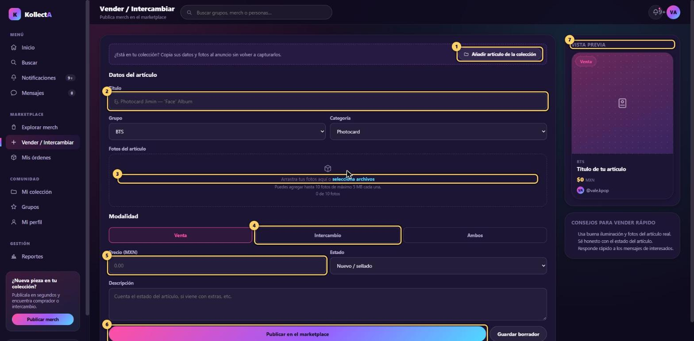

1. **Añadir artículo de la colección:** copia los datos y las fotos de una pieza que ya está en tu colección.
2. **Título** del artículo. Abajo eliges también el **grupo** y la **categoría** (photocard, álbum, lightstick…).
3. **Fotos:** arrástralas o selecciónalas. Hasta 10, de máximo 5 MB cada una.
4. **Modalidad:** **Venta**, **Intercambio** o **Ambos**.
5. **Precio** en MXN (solo en venta). A la derecha eliges el **estado** de la pieza (nuevo, buen estado…).
6. **Publicar en el marketplace.** También puedes **Guardar borrador**.
7. **Vista previa:** así se verá tu anuncio.

---

## 14. Mis órdenes

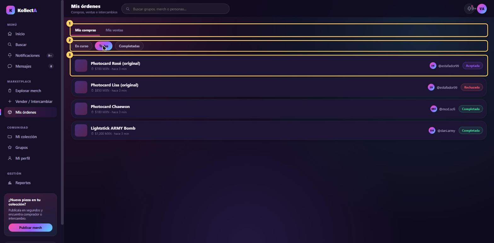

1. **Mis compras / Mis ventas.**
2. **Filtros:** **En curso**, **Todas** o **Completadas**.
3. **Orden:** muestra el artículo, el precio, la otra persona y el estado. Clic para ver el detalle.

---

## 15. Detalle de una orden y disputas

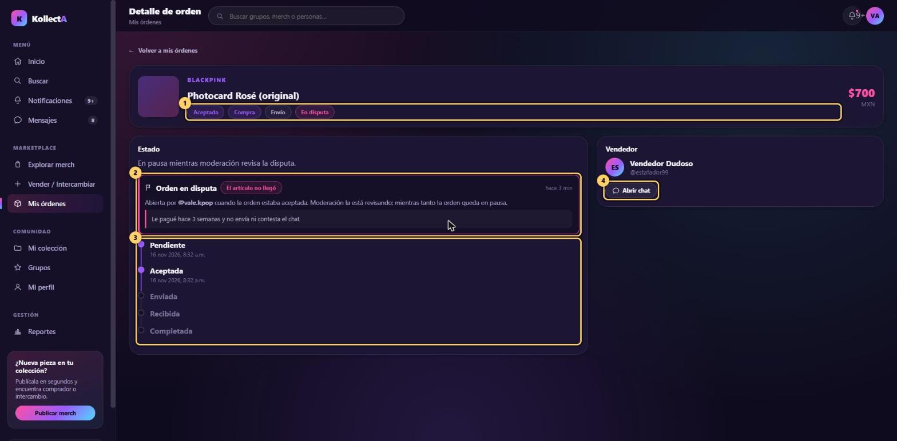

1. **Etiquetas:** estado, tipo (compra o intercambio), entrega (envío o en persona) y, si aplica, **En disputa**.
2. **Panel de la disputa:** motivo, quién la abrió, el detalle y, al final, la resolución de moderación.
3. **Línea de tiempo** de la orden.
4. **Abrir chat** con la otra persona.

**Cómo avanza una orden.** Los botones aparecen solos según tu papel en la orden:

| Paso | Quién lo hace |
|---|---|
| **Pendiente → Aceptada** (o Rechazada) | El vendedor. Al aceptar, el artículo queda apartado y las demás solicitudes se rechazan. |
| **Aceptada → Enviada** (solo con envío) | El vendedor. |
| **Enviada → Recibida** | El comprador. |
| **Recibida → Completada** | El vendedor. El artículo pasa a la colección del comprador. En un intercambio, las piezas ofrecidas pasan a la del vendedor. |
| **Cancelar** | Cualquiera de los dos, mientras la orden siga pendiente o aceptada. |

Cuando la orden se completa, el **comprador califica** al vendedor de 1 a 5 estrellas, con un comentario opcional. Esa calificación se suma a la reputación del vendedor.

**Abrir una disputa.** Si algo sale mal y no se resuelve en el chat (no llegó, no corresponde, parece falso, la otra persona no responde), usa **Abrir una disputa**, debajo de los botones de la orden. Solo se puede con la orden **aceptada, enviada o recibida**. Mientras moderación la revisa, la orden queda en pausa. Al resolverse, las dos partes reciben una notificación con la decisión, que puede ser:

- **Cancelar la operación:** los artículos vuelven a estar disponibles.
- **Darla por completada.**
- **Dejar que siga su curso.**

---

## 16. Mi colección

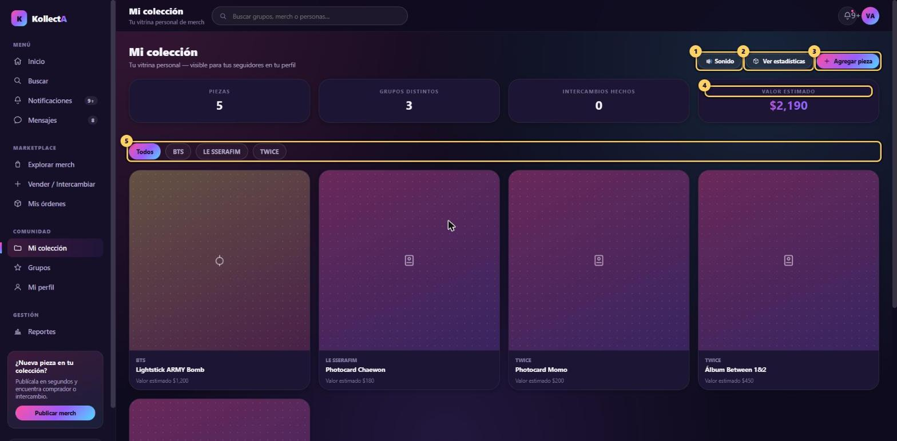

1. **Sonido:** activa o desactiva los efectos al ver tus piezas.
2. **Ver estadísticas** de tu colección.
3. **Agregar pieza:** guarda una pieza sin ponerla a la venta.
4. **Resumen:** piezas, grupos distintos, intercambios hechos y valor estimado.
5. **Filtro por grupo.**

Haz clic en una pieza para ver sus fotos y datos. Si es tuya, **Publicar en el marketplace** crea un anuncio con sus datos (la pieza en sí no se vende desde la colección). Tu colección se ve en tu perfil.

---

## 17. Perfil y reseñas

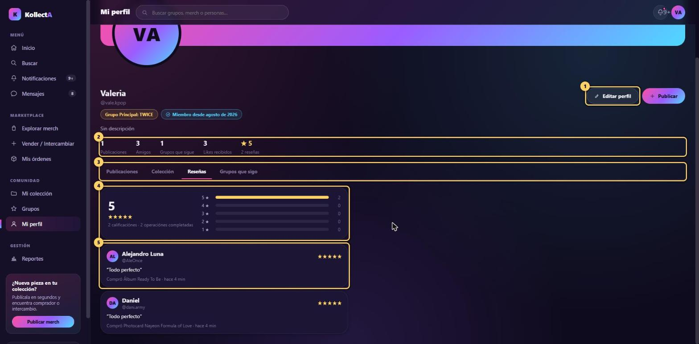

1. **Editar perfil:** nombre, descripción y foto. El botón **Publicar** de al lado crea una publicación.
2. **Estadísticas:** publicaciones, amigos, grupos que sigue y likes recibidos. Si la persona vende, aparece también su **★ reputación**; al hacerle clic se abren sus reseñas.
3. **Pestañas:** Publicaciones, Colección, Reseñas y Grupos que sigo.
4. **Resumen de reputación:** el promedio y cuántas calificaciones hay de cada número de estrellas.
5. **Reseña:** quién compró, cuántas estrellas dio, su comentario y qué compró.

En el perfil de otra persona aparecen **Agregar amigo** (o aceptar o cancelar la solicitud) y **Denunciar cuenta**. Si eres moderador o administrador, también los botones para suspender o banear.

---

## 18. Reportes

Cada rol ve sus reportes y los de los roles anteriores. Todos se pueden filtrar por fechas o meses y descargar en **CSV**.

**Usuario:**

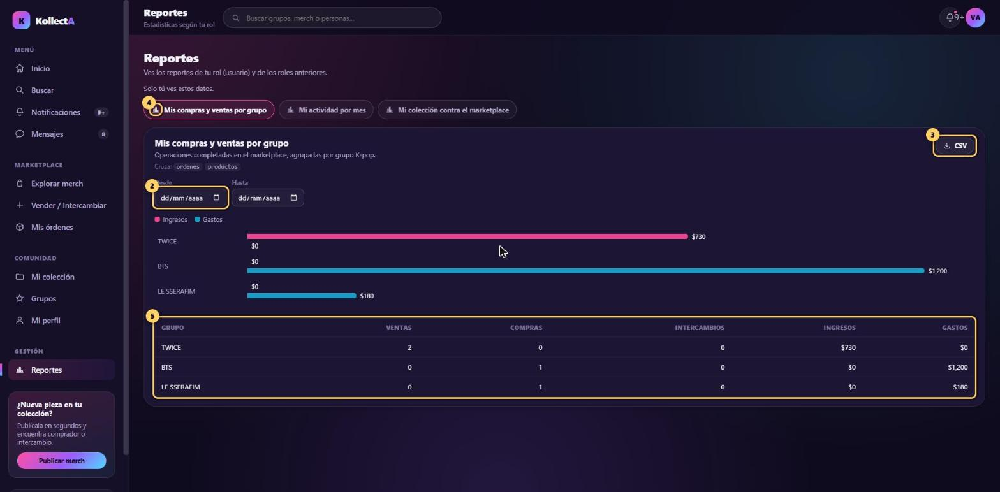

2. **Desde / Hasta:** filtra por fechas.
3. **CSV:** descarga la tabla para abrirla en Excel.
4. **Reportes disponibles:** mis compras y ventas por grupo, mi actividad por mes y mi colección contra el marketplace.
5. **Tabla** con los datos de la gráfica.

**Administrador:**

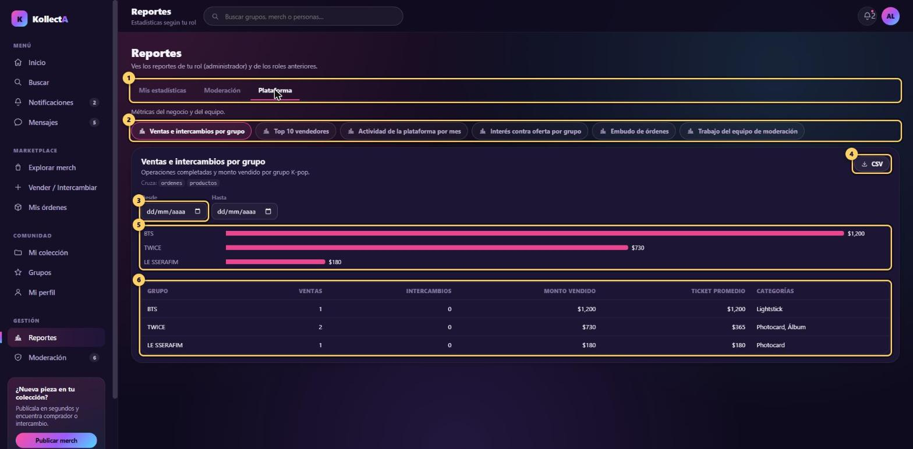

1. **Secciones:** **Mis estadísticas** (usuario), **Moderación** (moderador) y **Plataforma** (administrador).
2. **Reportes de la sección.** En Plataforma: ventas por grupo, top 10 vendedores, actividad mensual, interés contra oferta por grupo, embudo de órdenes y trabajo del equipo de moderación.
3. **Filtro de fechas.**
4. **CSV.**
5. **Gráfica.**
6. **Tabla.**

Los moderadores ven en **Moderación** las denuncias por motivo, las cuentas más denunciadas y los vendedores con más cancelaciones.

---

## 19. Moderación (moderadores y administradores)

La pantalla **Moderación** tiene cuatro pestañas: **Denuncias**, **Disputas**, **Usuarios** y **Bitácora**. El número junto a *Moderación* en el menú suma las denuncias y disputas pendientes.

### Denuncias

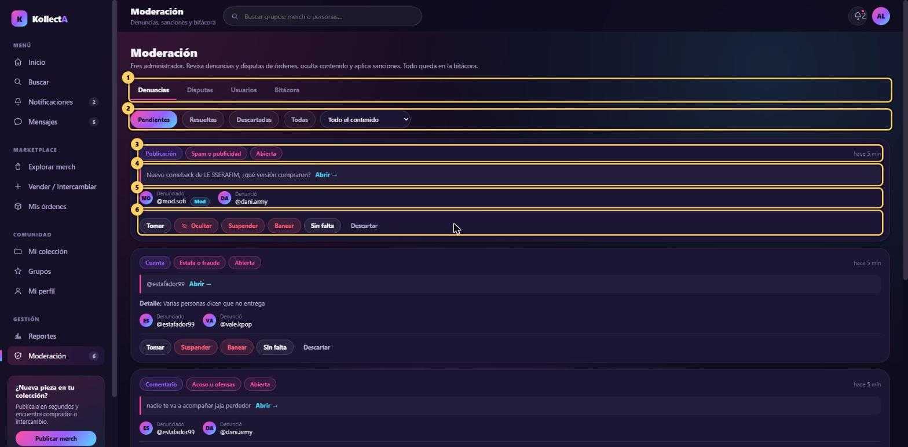

1. **Pestañas** de moderación.
2. **Filtros:** por estado (pendientes, resueltas, descartadas o todas) y por tipo de contenido.
3. **Etiquetas:** tipo de contenido, motivo, estado y cuántas personas denunciaron lo mismo.
4. **Contenido denunciado.** **Abrir →** lleva a donde está.
5. **Denunciado / Denunció.**
6. **Acciones:**
   - **Tomar:** te asignas la denuncia.
   - **Ocultar:** el contenido deja de verse para todos menos su autor.
   - **Suspender:** de 1 a 30 días.
   - **Banear:** solo administradores.
   - **Sin falta:** cierra la denuncia sin sanción.
   - **Descartar.**

   Todas las acciones piden un motivo y quedan en la bitácora.

### Disputas

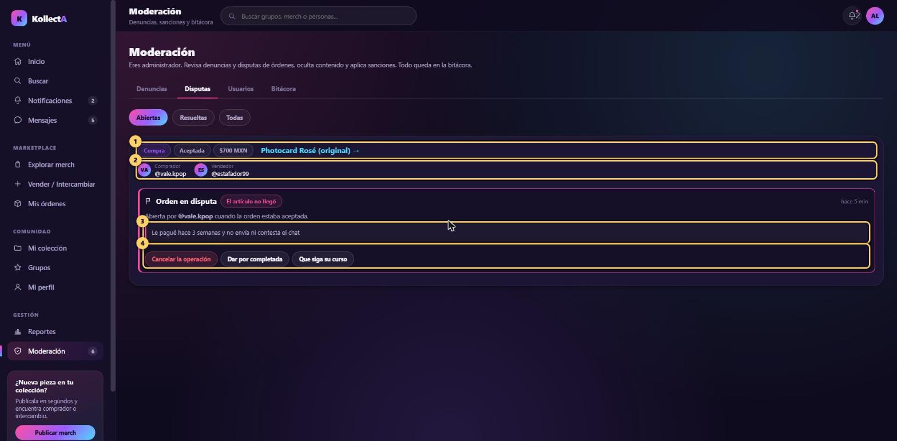

1. **Orden:** tipo, estado y precio. Clic en el título para abrirla.
2. **Comprador y vendedor.**
3. **Lo que explicó** quien abrió la disputa.
4. **Resolver:** **Cancelar la operación**, **Dar por completada** o **Que siga su curso**. La nota es obligatoria y la ven las dos partes.

### Usuarios

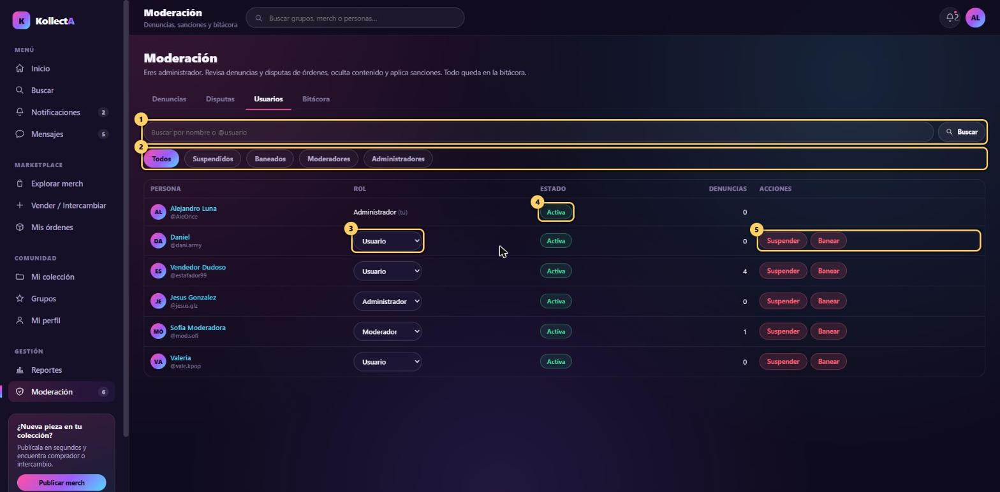

1. **Buscar** por nombre o @usuario.
2. **Filtros:** suspendidos, baneados, moderadores o administradores.
3. **Rol:** solo un administrador puede cambiarlo.
4. **Estado de la cuenta:** activa, suspendida (hasta qué fecha) o baneada.
5. **Acciones:** suspender, levantar la suspensión, banear o reactivar.

**Bitácora:** registro de quién hizo qué, sobre quién y por qué. Un moderador ve sus propias acciones; un administrador, las de todo el equipo.

**Reglas que la app hace cumplir:**

- Nadie se modera a sí mismo.
- Un moderador no puede actuar sobre otro moderador ni sobre un administrador.
- Nadie atiende una denuncia o disputa en la que participa.
- Siempre debe quedar al menos un administrador activo.

---

## 20. Denunciar contenido

Puedes denunciar publicaciones, comentarios, productos y cuentas con el botón **Denunciar** o la banderita 🏳.

1. Elige el motivo: spam, acoso, merch falsa, estafa, contenido inapropiado u otro.
2. Si quieres, agrega detalles. Si el motivo es "Otro", son obligatorios.
3. Pulsa **Enviar denuncia**.

Nadie más sabe quién denunció. Recibirás una notificación cuando moderación la revise. No puedes denunciar dos veces lo mismo.

---

## 21. Preguntas frecuentes

**No puedo entrar y dice que mi cuenta está suspendida.** La suspensión termina sola en la fecha indicada. Si crees que es un error, escribe al equipo de KollectA.

**¿Cómo pago una compra?** Ponte de acuerdo con la otra persona en el chat de la orden. La app no maneja dinero. Si no cumplen lo acordado, abre una disputa ([§15](#15-detalle-de-una-orden-y-disputas)).

**¿Por qué ya no veo un producto en el marketplace?** Puede que ya esté apartado por otra orden, se haya vendido, el vendedor lo haya retirado o moderación lo haya ocultado.

**¿Quién ve mi colección?** Cualquier persona con cuenta que entre a tu perfil.

**¿Moderación lee mis mensajes privados?** No. La moderación no tiene acceso a los chats.

**¿Puedo instalar KollectA como app?** Sí. En Chrome o Edge (computadora o Android) aparece **📲 Instalar app** en el menú lateral, o un aviso abajo de la pantalla en el celular; también puedes usar el ícono de instalar de la barra de direcciones. En iPhone abre la página en Safari, toca **Compartir** y luego **Agregar a inicio**. La app se abre en su propia ventana, con el ícono de KollectA.
